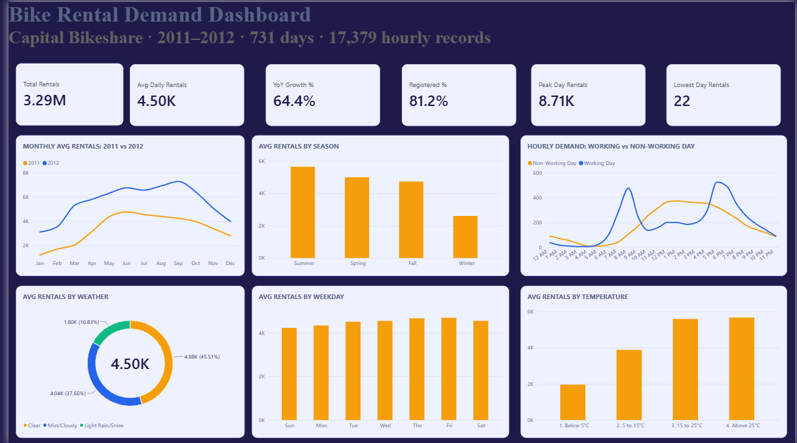

# 🚲 Bike Rental Demand Analytics

## Demand Analysis | Weather & Seasonal Effects | Daily Rental Prediction

## 📌 Project Overview
This project analyzes Capital Bikeshare rental data (2011-2012) to understand how weather, season, and calendar factors affect bike rental demand, and builds machine learning models to predict the **daily bike rental count**.

The project uses **Python, SQL, and Power BI** to perform data quality checks, exploratory data analysis, business analysis, machine learning, model comparison, and interactive dashboard development.

## 🎯 Business Objective
The main objectives are:

- Prepare a complete data analysis report on the bike sharing data.
- Understand how season, weather, and time of day affect rental demand.
- Compare casual and registered user behavior.
- Predict daily bike rental count from environmental and seasonal settings.
- Compare multiple models and recommend the best one for production.
- Document the challenges faced and the techniques used to solve them.

## 📂 Dataset
- **Dataset:** Bike Sharing Dataset (Capital Bikeshare, Washington D.C.)
- **Source:** UCI Machine Learning Repository (Fanaee-T and Gama, 2013)
- **Period:** 2011 to 2012
- **Target Variable:** `cnt` (total daily bike rentals)

| File | Records | Columns | Description |
|---|---:|---:|---|
| `day.csv` | 731 | 16 | Daily rentals with weather and calendar data |
| `hour.csv` | 17,379 | 17 | Hourly rentals (adds the `hr` column) |

`day.csv` is used for modelling because the task is to predict the daily count. `hour.csv` is used for hourly demand analysis.

## 🛠️ Tools & Technologies

- **Python:** Pandas, NumPy, Matplotlib, Seaborn, Scikit-learn, ydata-profiling
- **SQL:** MySQL
- **Power BI:** Dashboard development, DAX, data visualization
- **GitHub:** Project documentation and version control

## 🔍 Project Workflow

### 1. Python – Data Analysis & Machine Learning
- Data loading and inspection of both files
- Automated data profiling report
- Data quality checks (missing values, duplicates, strange values)
- Data cleaning (humidity value of 0 replaced with the median)
- Exploratory Data Analysis (trend, season, weather, users, hourly patterns)
- Outlier and correlation analysis
- Feature preparation (dummy variables, scaling, train/test split)
- Machine learning model development
- Model evaluation, hyperparameter tuning, and comparison

### 2. SQL – Business Data Analysis
SQL was used to perform business-focused analysis, including:

- Data quality checks (missing values, duplicates, hourly totals vs daily totals)
- Year-wise growth analysis
- Season, month, weekday, and holiday analysis
- Weather and temperature band analysis
- Casual vs registered user analysis
- Hour-wise demand analysis (working days vs non-working days)
- Best and worst rental days

### 3. Power BI – Interactive Dashboard
An interactive dashboard was created to visualize key bike rental insights.



## 📈 Key Insights

- The dataset contains **731 daily records** and **17,379 hourly records** with no missing values and no duplicates.
- Average daily rentals grew from about **3,406 (2011)** to about **5,600 (2012)**, a **64.4% increase**.
- **Summer** is the busiest season (about 5,644 rentals/day), followed by spring (4,992) and fall (4,728). **Winter** is the lowest (2,604).
- **Clear days** average about 4,877 rentals, misty days 4,036, and **light rain or snow days only 1,803**.
- **Temperature** is the strongest weather factor (correlation about 0.63). `temp` and `atemp` are 0.99 correlated.
- **Registered users** make up about **81.2%** of rentals and dominate working days (3,978 vs 607 casual).
- **Casual users** more than double on non-working days (1,371 vs 607).
- Working days show **commuter peaks at 8 AM and 5-6 PM**, while non-working days have a single afternoon peak.
- Holidays have lower demand (about 3,735) than non-holidays (about 4,527).
- One day had an impossible humidity value of 0, which was replaced with the median.

## 🤖 Machine Learning

Regression models were developed to predict the daily number of bike rentals.

Models evaluated:

- Linear Regression
- KNN Regressor
- Support Vector Regressor (SVR)
- Decision Tree
- Random Forest
- Gradient Boosting
- Tuned Gradient Boosting

### Model Performance

| Model | Test R² | CV R² | MAE | RMSE |
|---|---:|---:|---:|---:|
| Tuned Gradient Boosting | 0.898 | 0.873 | 453 | 639 |
| Gradient Boosting | 0.893 | 0.866 | 470 | 654 |
| Random Forest | 0.874 | 0.842 | 470 | 710 |
| SVR | 0.872 | 0.839 | 524 | 716 |
| Linear Regression | 0.840 | 0.817 | 586 | 801 |
| Decision Tree | 0.755 | 0.737 | 652 | 991 |
| KNN | 0.616 | 0.542 | 1061 | 1241 |

**Best-performing model:** Tuned Gradient Boosting based on test R², cross-validated R², and lowest error.

The best model explains about **90% of the variation** in daily rentals, with an average error of about **453 bikes per day** (roughly 10% of the average daily demand of 4,504).

**Most important features:** temperature (about 0.51), year (about 0.29), humidity (about 0.07), fall season, and wind speed.

*Note: `casual` and `registered` were excluded from the features because they add up exactly to the target (data leakage), and `atemp` was excluded because it is 0.99 correlated with `temp`.*

## 🧩 Challenges Faced

| Challenge | Technique Used |
|---|---|
| `casual + registered = cnt` (data leakage) | Dropped both columns |
| `temp` and `atemp` highly correlated (0.99) | Dropped `atemp` |
| Humidity value of 0 (recording error) | Replaced with the median |
| Category codes stored as numbers | Dummy variables (one-hot encoding) |
| Features on different scales | StandardScaler for Linear, KNN, and SVR |
| Outliers in wind speed and casual users | Kept them (real events, trees are robust) |
| Strong growth between 2011 and 2012 | Kept `yr` as a feature |
| Small dataset (731 days) | 5-fold cross-validation and grid search |

## 💡 Business Recommendations

- Increase bike availability in **summer and spring**, and plan maintenance during low-demand winter months.
- Make sure bikes are stocked and rebalanced before the **8 AM and 5-6 PM** commuter peaks on working days.
- Use weather forecasts to plan fleet availability, since rain and snow cut demand by more than half.
- Offer weekend and holiday promotions to attract more **casual users**.
- Offer membership plans for casual users to convert them into registered users, who make up the majority of demand.
- Retrain the prediction model regularly, because demand is growing over time.

## 📁 Project Structure

```text
Bike-Rental-Demand-Analytics/
│
├── Python/
│   └── BikeRental.ipynb
│
├── SQL/
│   └── BikeRental.sql
│
├── powerBi/
│   ├── BikeRental.pbix
│   └── BikeRental_dashboard.png
│
├── Dataset/
│   ├── day.csv
│   └── hour.csv
│
└── README.md
```

## 🚀 Conclusion

This project demonstrates an end-to-end data analytics workflow by combining Python-based analysis, SQL business queries, machine learning, and Power BI visualization.

The analysis shows that bike rental demand is driven mainly by **temperature, season, weather, and business growth**, with clear commuter patterns on working days. The tuned Gradient Boosting model predicts daily rentals with about 90% accuracy (R²) and can support fleet planning and marketing decisions.

---

**Created by:** Hemanth Kumar Reddy  
**Role:** Aspiring Data Analyst  
**Skills:** Python | SQL | Power BI | Excel | Data Analysis | Machine Learning
